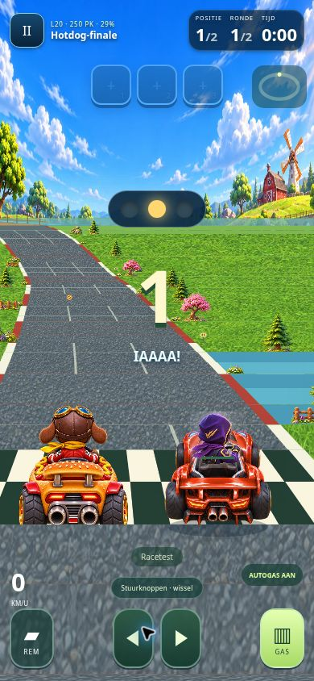

# Kart Go — gelijke start, verhouding, rechte hond en korter ijs

13 november 2026. **Bedacht door Jaylenn.** Uitgangspunt `1485453cfa9e54666496c31c4a53c7751ab6da93`.

## Gerichte correcties

- De screenshot toont de oorspronkelijke Hotdog-finale (level 20), niet de aparte multiplayerrenderer. De baas kreeg daar 1700 afstandseenheden voorsprong en een extra schaalfactor 2,15. Beide zijn verwijderd voor de drie eindbaasraces 20/50/70.
- Nieuwe race: speler en baas staan allebei op afstand 0, in twee naast elkaar liggende startplaatsen. De eerste meters gebruiken een gezamenlijk startkader zodat beide volledige karts in beeld passen; daarna keert het bestaande volgbeeld terug. De grondlijn en schaal komen overeen. Een hervatte race behoudt zijn opgeslagen afstand.
- De Hotdog-Hond heeft een rechte achteraanblik van dezelfde hond/hotdog-kart, afgeleid van het bestaande boss-atlas. `assets/graphics/hotdog-rear-v7.webp`, transparant, 1254×1254, 280054 bytes. De oude atlas blijft intact; Pizza/Burger zijn niet opnieuw ontworpen. Extra scheefrotatie van eindbaassprites verwijderd en rechthoek genormaliseerd naar dezelfde 154×154 tekenmaat als de gewone kart.
- IJs bevriest **1,2 seconde** in plaats van twee seconden, zowel ontvangen boss-projectielen als de eigen IJs-power-up en de gedeelde online/Party-simulatie. De tienseconden-schietcadans blijft gelijk. Beschrijvingen en timingtests aangepast; bewaarde oude singleplayer-vriestijd wordt bij hervatten begrensd op 1,2.
- Ook de online eindbaas krijgt geen afstandsvoorsprong meer. Overige botprestaties, aanvalstypen, wapenkansen en parcoursregels behouden.

## Expliciet behouden en gecontroleerd

- Alle invoerhandlers, stuurgevoeligheid, gas/rem/autogas, assistentie en spelerbewegingsphysics ongewijzigd. De updatefunctie tot en met de spelerbeweging is exact vergeleken met de eerdere bron.
- `course.js`, `scenery.js`, `desert.js`, `ice-world.js`, `race-adventure.js`, alle bestaande CSS en omgevingsafbeeldingen ongewijzigd. Geen extra parcoursen, hindernissen of menuverbouwing.
- Beide lokale opslagkeys, bestaande voortgang, garagekeuzes en racehervatten blijven behouden.

## Verificatie

- `npm test` geslaagd: oorspronkelijke races, drie besturingen, multitouch, power-ups tijdens sturen/gas, opslag en echte Party-controller. Nieuwe `tests/boss-fairness.cjs` controleert alle drie eindbazen op 320×568, 390×844, 844×390 en 1363×936: afstand 0, gelijke schaal/grondlijn, volledige karts binnen het scherm, wachten op GO en terugkeer naar bestaand volgbeeld. Ook werkelijk hervatten na 1,2 seconde ijs en de echte sprite-tekenaanroep zonder extra rotatie getest.
- `worlds-simulation` en `stunts-bots` geslaagd: gedeelde ijsduur, bestaande events, bochten/schansen, botwapens en snelheid.
- `server-repair` geslaagd: twee echte workerd-clients, hervatten, identiteitsbehoud, zes plekken, organisatorrechten, opslagherstart en identieke finishuitslag.
- Echte Chrome in een telefooniframe van 390×844: via het gewone menu Vrij racen → level 20 gestart. Beide karts naast elkaar op dezelfde checkerlijn, rechte achteraanblik en correcte verhouding visueel beoordeeld. Geen fysieke iPhone/Androidtest claimen.

## Publicatie

Codecommit `a7906a7f3016803c89d2b46f7d5c17c39274cf2c` live op de bestaande speellink. Pages build/deploy/report en Cloudflare Workers Builds **success**. Scriptcache `boss-fair-1`; echte `/health`: `boss-fair-4.1`.

Zes publieke HTML/JS/WebP-bestanden HTTP 200 en exact gelijk aan de geteste lokale bestanden, inclusief de nieuwe transparante hond.

`node tests/boss-live.mjs` op productie **geslaagd**: twee onafhankelijke echte WebSocket-clients zien de baas en spelers op afstand 0 vóór GO, identieke ijsstatus na een echte boss-treffer, maximaal 1,2 seconde bevroren en daarna weer versnellen. Geen uitnodigingsgegevens in log of screenshot.

Gepubliceerde rootgame via het normale menu op 390×844 geopend, Vrij racen → Hotdog-finale. De echte geladen afbeelding en beide startplaatsen op dezelfde checkerlijn visueel bevestigd. Geen fysieke iPhone/Androidtest.

## Afbeelding

Via beeldgeneratie de bestaande bovenste rechter atlas-cel omgezet naar één rechte, symmetrische achteraanblik met transparantie. Promptkern: dezelfde bruine hond met leren vliegenierskap, gele sjaal en rood racejack; dezelfde hotdog-kart, gouden sesambroodjes, ketchup/mosterd, zwarte banden en dubbele uitlaten; perfect recht van achteren, geen scheve driekwartoriëntatie, geen omgeving of tekst. Alleen PNG→WebP-bestandsconversie nadien; het origineel buiten het project bewaard.
